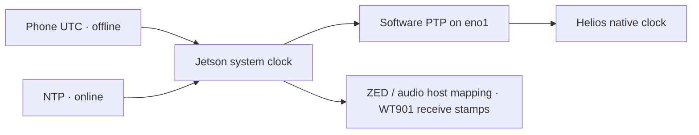

# Sensor time synchronization

The topology is **phone time when offline**, or NTP when online, → Jetson
system clock → software PTP on `eno1` → Helios native packet timestamps.
ZED, WT901 and audio use host time through
their respective drivers; they are not PTP endpoints. See [VALIDATION.md](VALIDATION.md)
for the actual measurements and [../TODO.md](../TODO.md) for calibration work.



Select one host reference at a time; phone sync explicitly disables NTP.
`eno1` does not have a separate hardware clock to set.

## Current Jetson configuration

- Online, WiFi can supply systemd-timesyncd NTP. Offline, the phone can supply
  UTC through the web app over the helmet hotspot or any local network.
  Internet access is not required for phone sync or local PTP.
- Dedicated Ethernet: Jetson `eno1`, `192.168.1.102/24`; Helios `192.168.1.200`.
- `ethtool -T eno1` exposes software timestamping, without a PTP hardware clock.
  `musohu-ptp.service` serves system time using linuxptp, UDPv4/E2E, domain 0.
- The selected phone/NTP reference controls host time. `masterOnly` and `free_running` prevent
  ptp4l from becoming a client or disciplining the host clock. No phc2sys runs;
  the service has no `CAP_SYS_TIME` capability.
- Helios `TimeSyncSrc=PTP-E2E-L4`, domain 0. Other device fields were preserved
  and read back after configuration, including IP addresses and rotation rate.
- Bringup uses `use_lidar_clock: true` and XYZIRT clouds with absolute per-point
  `timestamp` values. Cloud header time is the first point's time, so a cloud
  delivered after a full revolution is older than the individual UDP packets.

This is software synchronization, not a measured hardware synchronization
accuracy. Packet receive-minus-acquisition age includes buffering and network
transit. The short stable test observed a median 7.9 ms and p95 8.4 ms; these
are delivery-age measurements, not PTP error bounds. The device's displayed
master-offset value is retained as raw telemetry because its unit was not
confirmed. No leap-second offset was added: native packet epoch was checked
against host UTC after lock.

## Setup and verification

Run as the normal user; installation requests sudo in that terminal:

```bash
./musohu_ws/scripts/ptp.sh --install --interface eno1
./musohu_ws/scripts/ptp.sh --status --interface eno1
# Read device settings/lock while ROS is running:
python3 musohu_ws/scripts/lidar-time.py
# Stop the ROS LiDAR launch before binding its UDP ports:
python3 musohu_ws/scripts/lidar-time.py --sample 5 --output /tmp/helios-clock.json
# Only when provisioning a device that is not already configured:
python3 musohu_ws/scripts/lidar-time.py --set-ptp --sample 5 --output /tmp/helios-config.json
```

The installer enables the source at boot and does not change addresses, WiFi,
hotspot settings or the host NTP service. `--stop` disables only musohu-ptp.
The configuration in [config/ptp4l.conf](config/ptp4l.conf) targets Ubuntu's
linuxptp 3.1.1. Follow its supported option names when upgrading the package.
[linuxptp documentation](https://www.linuxptp.org/documentation/ptp4l/).

With native LiDAR time enabled, `lidar.launch.py` checks device lock and samples
actual MSOP timestamps **before** starting the driver. An unavailable/unlocked
clock, occupied UDP port or packet epoch outside ±0.1 s of host receive time
blocks that launch. Wait for lock after power-up and retry. It never silently
switches a recording back to host-derived LiDAR timestamps.

`/diagnostics` includes `MuSoHu time sync` every five seconds: host NTP state,
local PTP service state, device lock and raw reported offset. Loss of the
source/lock raises ERROR; an unknown/stale UTC reference raises WARN. A valid
phone-set reference is accepted even with NTP disabled. This monitoring
does not stop an active bag or repair its timestamps. Inspect the recorded
diagnostics before accepting a session for timing-sensitive experiments.

## Offline phone workflow and battery swaps

1. After powering the rig or swapping a battery, connect the phone to the
   helmet hotspot (or the same LAN) and open the **new** web app.
2. Leave recording and sensor launches stopped. The app rejects clock changes
   while its own ROS processes or detected external sensor/recorder processes
   are active. Changing wall time during a bag would break timestamp continuity.
3. Click **Sync from this phone**. The browser sends UTC epoch milliseconds;
   changing the Jetson's timezone is unnecessary. The backend disables NTP,
   sets host UTC using a narrowly permitted command and records the reference.
4. Software ptp4l already reads the host system clock. There is no separate
   Ethernet clock to set or phc2sys to run. The app waits for Helios lock and
   samples native MSOP packet epochs against the newly set host time. It shows
   success only after that check passes; if the LiDAR is absent or slow to
   recover, it explicitly reports host success with LiDAR not ready.
5. Start sensors, then recording. The existing LiDAR launch guard rechecks
   lock and packet epoch. The web app requires a valid UTC reference before
   starting hardware; dummy development remains available without it.

The phone reference is saved in `~/.local/state/musohu/clock.json`, including
boot ID and monotonic/UTC correspondence. It expires after 24 hours, after a
reboot/battery swap or if another process steps wall time by more than two
seconds. NTP must remain disabled for it to be accepted. Session metadata
includes the selected reference at recording start and stop; `/diagnostics`
shows `host_reference=phone` without requiring internet NTP synchronization.
A stale kernel `NTPSynchronized=yes` flag with NTP disabled is not sufficient.

When internet time is desired again, stop the sensors/recording and click
**Use internet time**. Wait for the status to identify NTP as ready before
restarting; enabling NTP alone is not confirmation of synchronization.

Run `scripts/setup/setup_time_sync_permissions.sh` once as the normal service
user to install narrow sudo permissions. The current machine already has
legacy date/set-ntp permissions; a clean deployment needs the helper. The new
service template uses `NoNewPrivileges=false` because these specific sudo
operations must elevate. Preparation does not change the deployed old service.
Neither sync mode changes WiFi/hotspot configuration or sensor network addresses.
The older checkout's `/sync_time` does not perform these new guards/checks.

Live verification on 2026-10-15 stepped host time forward and backward two
seconds with NTP disabled. Both requests verified native LiDAR time again
within about 4–5 seconds, without restarting PTP; a following full offline bag
recorded healthy phone-reference diagnostics. This tests real clock/PTP behavior
with emulated phone epochs, not physical phone UTC accuracy or an actual battery
power cycle. See [VALIDATION.md](VALIDATION.md).

## Timestamp meaning by sensor

| Stream | Timestamp source | Remaining uncertainty |
| --- | --- | --- |
| Helios XYZIRT | PTP-disciplined native packet/point clock | Software PTP error, delivery latency, LIO field conversion |
| ZED images, depth, IMU, VIO | SDK `SYSTEM_CLOCK` mapping to host time | USB/SDK mapping latency and cross-sensor offset; not direct PTP |
| WT901 | Host receive time from the serial driver | Serial latency, 10 Hz sensor output, orientation freshness |
| `/audio_stamped` | PortAudio ADC/current-time pair mapped to host UTC; receive-time fallback if unavailable | USB/audio oscillator drift and acoustic/IMU alignment |
| `/audio` | Legacy headerless PCM16 | Bag receive time only; use `/audio_stamped` for new recording |

`/audio_info` describes the main mono 16 kHz S16LE stream; each stamped channel
also remains available as `/audio/channelN/stamped`. VAD/DOA are asynchronous
control observations and may publish only on changes. Host UTC quality still
depends on the selected phone/NTP reference. Local PTP continues without
internet. A phone reference carries the phone's own UTC error plus uncalibrated
HTTP/command latency; it is not an internet-disciplined precision time source.
No measured inter-sensor offset, extrinsic calibration or LIO comparison has
been claimed. Preserve raw data and calibrate timing before those experiments.
